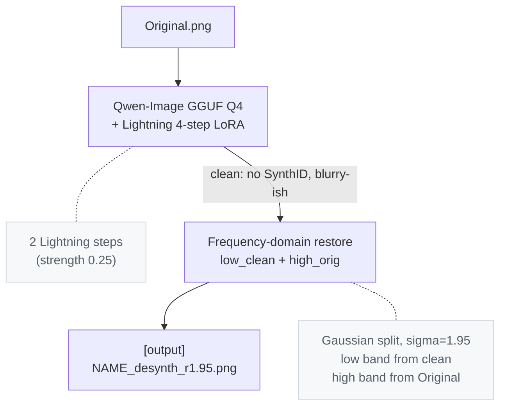

# Desynth

A tool & pipeline for removing OpenAI & Google's SynthID watermark from images.
This project is intended solely for research, education, and authorized evaluation.

## Results
Edge Mode:

Gaussian Mode (Default):


## Metrics
All scores are input image vs output via the included `compare.py`.

### Against other research (Gemini/Google, 2752×1536)

| metric                 | our method | [competitor](https://github.com/00quebec/Synthid-Bypass) |
|------------------------|--------------:|-----------------:|
| PSNR                   |  **28.75 dB** |  20.21 dB        |
| SSIM                   |     **0.946** |     0.624        |
| SSIM (low-frequency)   |     **0.944** |     0.812        |
| SSIM (high-frequency)  |     **0.987** |     0.641        |
| MAE (lower is better)  |      **5.33** |    12.18         |
| Output resolution      |   2752×1536   |    1501×835      |
| SynthID verdict        |   not found   |    not found     |


### Our own test image (GPT Image 2.0/OpenAI, 1460×1078)

| metric                 | gaussian (default) | edge mode |
|------------------------|--------------:|--------------:|
| PSNR                   |  **32.47 dB** |   31.47 dB    |
| SSIM                   |     **0.956** |     0.948     |
| SSIM (low-frequency)   |     **0.959** |     0.955     |
| SSIM (high-frequency)  |     **0.991** |     0.984     |
| MAE                    |      **3.82** |     4.08      |
| SynthID verdict        |   not found   |   not found   |

* Edge mode trades a small amount of measurable detail for better perceptual
shape continuity at contours.


## How it works



## Usage

### Install and prepare

Install Python 3.11 and a working GNU Make, then open a terminal in the repository root.
On Windows, use the [Python 3.11.9 64-bit installer](https://www.python.org/downloads/release/python-3119/)
and ensure GNU Make is available as `make` in `PATH`.
No virtual environment activation is needed.

```powershell
make setup
```

If GNU Make is unavailable or fails to start, the same setup can be run directly:

```powershell
py -3.11 scripts/project.py setup
```

On Linux/macOS, replace `py -3.11` with `python3.11`. The helper also accepts
`--venv` and `--backend` options; `--backend` accepts `auto`, `cuda`, or `cpu`.

`setup` creates `.venv`, installs all dependencies (including comparison tools),
downloads missing GGUF and LoRA model files, caches the VAE and pipeline configs
from Hugging Face, and runs a readiness check. Existing model files are skipped.
The two model downloads total approximately 14.5 GB; allow additional space for
the virtual environment and Hugging Face cache. Keep the included `embeds_cache.pt`
in the repository root: the pipeline requires these precomputed embeddings.

`make` alone shows help. Individual preparation steps are available:

| target | action |
|--------|--------|
| `make venv` | create the virtual environment |
| `make install` | install dependencies without downloading model files |
| `make models` | download missing GGUF and LoRA model files |
| `make prepare` | cache the VAE and pipeline configs from Hugging Face |
| `make doctor` | check Python, imports, PyTorch/CUDA, and model assets without loading the large pipeline |

By default, `PYTHON` is `py -3.11` on Windows and `python3.11` elsewhere.
`VENV` defaults to `.venv`. Override either when needed:

```powershell
make setup PYTHON="py -3.11" VENV=.venv
```

`BACKEND=auto` (the default) selects CUDA dependencies on Windows/Linux and
CPU dependencies on macOS. Choose `BACKEND=cpu` for a machine without NVIDIA
CUDA, or `BACKEND=cuda` explicitly. Use the same override for subsequent
installation commands:

```powershell
make setup BACKEND=cpu
```

The CUDA dependency set is in `requirements.txt`; the CPU dependency set is in
`requirements_mac.txt`. The pipeline selects CUDA, Apple MPS, or CPU according to
the hardware available to PyTorch.

Models can also be downloaded manually into the repository root:

| file                                                      | size   | source |
|-----------------------------------------------------------|--------|--------|
| `qwen-image-2512-Q4_K_M.gguf`                             | ~13 GB | [Frederic75/Qwen-Image-2512-GGUF](https://huggingface.co/Frederic75/Qwen-Image-2512-GGUF) |
| `Qwen-Image-2512-Lightning-4steps-V1.0-fp32.safetensors`  | ~1.6 GB | [lightx2v/Qwen-Image-2512-Lightning](https://huggingface.co/lightx2v/Qwen-Image-2512-Lightning) |


### Run

```powershell
make run INPUT=original.png
make run INPUT="path/to/image.png" ARGS="--seed 42"
```

To invoke Python directly on Windows:

```powershell
.\.venv\Scripts\python.exe desynth.py original.png --seed 42
```

On Linux/macOS, use `.venv/bin/python` instead of `.\.venv\Scripts\python.exe`.
If `VENV` was overridden, use that directory in direct Python commands.

Output: `out/<name>_desynth_s8_d0.250_p1_r1.95.png`. Random seed per run by
default. `make prepare` caches the VAE and configs ahead of time; otherwise
the first pipeline run downloads them from Hugging Face.

### Flags

| flag                  | default | when to use |
|-----------------------|---------|-------------|
| `--seed N`            | random  | reproducible runs |
| `--denoise X [X X]`   | 0.25    | sweep denoise |
| `--steps N`           | 8       | per-pass step count |
| `--passes N`          | 1       | iterate img2img |
| `--restore-sigma X`   | 1.95    | tune detail restore |
| `--restore-mode M`    | gaussian | `edge` for shape-coherent contours |
| `--unsharp X`         | 0.0     | post-restore sharpen; 0.2 is the perceptual sweet spot |
| `--no-restore`        | off     | skip the frequency restore step |
| `--keep-intermediate` | off     | save the pre-restore clean output |
| `--transformer PATH`  | Q4_K_M  | try a different GGUF quant |

### Quality check

```powershell
make compare INPUT=original.png OUTPUT=out/original_desynth_s8_d0.250_p1_r1.95.png
```

Prints PSNR, SSIM (full + low/high band), MAE, MSE, and per-channel
histogram correlation. Use paths matching your actual input and output filenames
(including their letter case on Linux/macOS).

To save a side-by-side comparison with the metrics:

```powershell
make visual INPUT=original.png OUTPUT=out/original_desynth_s8_d0.250_p1_r1.95.png VISUAL_OUT=out/comparison.png
```

The equivalent direct command on Windows is:

```powershell
.\.venv\Scripts\python.exe compare.py original.png out/original_desynth_s8_d0.250_p1_r1.95.png --visual --visual-out out/comparison.png
```

The saved visualization shows the two images side by side.

### Pixel difference

`diff.py` compares all four RGBA channels, including alpha. `--out` saves a
visible RGBA visualization with opaque display alpha (255). Color differences
are amplified; alpha differences also brighten all three color channels using
`max(abs(RGB delta), abs(alpha delta)) * gain`, clipped to 255. Black indicates
no change; brighter pixels indicate larger changes. The default gain is 8.
Images with different dimensions are rejected.

```powershell
make diff INPUT=original.png OUTPUT=out/original_desynth_s8_d0.250_p1_r1.95.png
```

`DIFF_OUT` defaults to `out/diff.png`; `GAIN` defaults to `8`. The equivalent
direct command on Windows is:

```powershell
.\.venv\Scripts\python.exe diff.py original.png out/original_desynth_s8_d0.250_p1_r1.95.png --out out/diff.png --gain 8
```

Optional outputs are disabled by default:

- `--preview-out PATH` / `PREVIEW_OUT=PATH`: two opaque panels, with RGB
  differences on the left and alpha differences in grayscale on the right.
- `--raw-out PATH` / `RAW_OUT=PATH`: the per-channel RGBA delta. Use `--gain 1`
  / `GAIN=1` for exact values. This data PNG can be fully transparent when alpha
  is unchanged; the main visualization stays visible.

## Files

| file                                                      | role                                                       |
|-----------------------------------------------------------|------------------------------------------------------------|
| `desynth.py`                                              | main pipeline: img2img + restore in one call               |
| `compare.py`                                              | similarity metrics between two images                      |
| `diff.py`                                                 | visible RGBA difference, optional raw delta and channel preview |
| `Makefile`                                                | setup, readiness checks, and image workflow commands        |
| `make/config.mk`, `make/setup.mk`, `make/run.mk`            | shared configuration, setup targets, and run targets        |
| `scripts/project.py`                                      | cross-platform setup and readiness helper                   |
| `requirements.txt`, `requirements_mac.txt`                 | CUDA and CPU dependency entry points                        |
| `embeds_cache.pt`                                         | cached prompt embeddings (~430 KB)            |
| `qwen-image-2512-Q4_K_M.gguf`                             | Qwen-Image transformer, GGUF Q4 quant (~13 GB)             |
| `Qwen-Image-2512-Lightning-4steps-V1.0-fp32.safetensors`  | 4-step Lightning distillation LoRA (~1.6 GB)               |

## Hardware Requirements

Tested on Windows 10, RTX 5060 Ti 8 GB, 32 GB DDR4 RAM.
Sequential CPU offload is required with < 12GB VRAM

## Known limitations

- Lightning's 4-step distillation is the source of most of the residual
  drift.
  (Dropping it for proper 20+ step sampling would likely tighten metrics further at the cost of 5x longer
  runs.)

## Credits

Baseline workflow and watermark hypothesis from
[00quebec/Synthid-Bypass](https://github.com/00quebec/Synthid-Bypass).
This pipeline reimplements the core idea in plain Python without ComfyUI,
ControlNet, or the face-detail path, and replaces the heavier redraw with a
two-step minimum denoise + frequency-domain restore.
