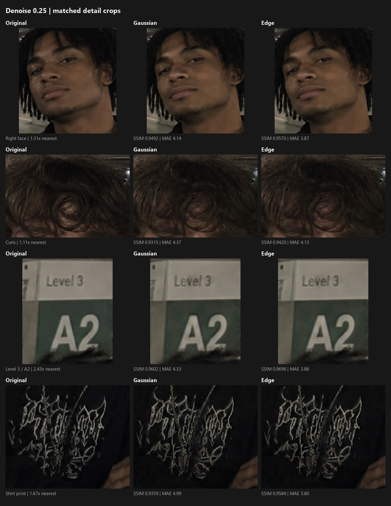
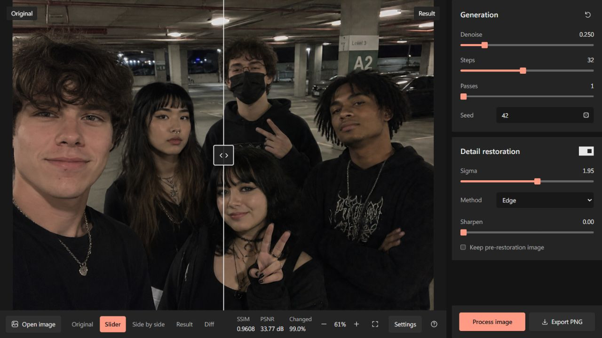
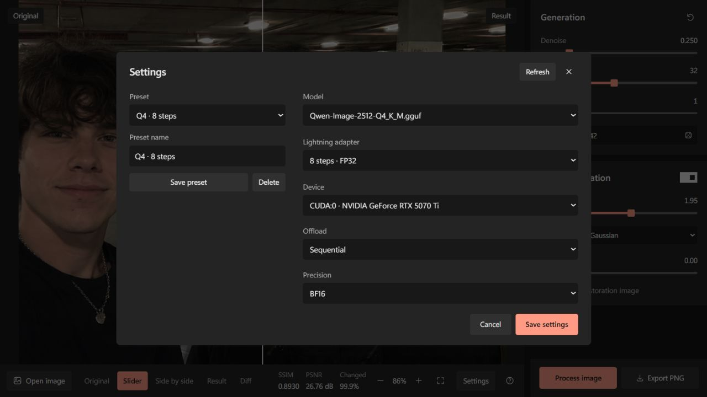
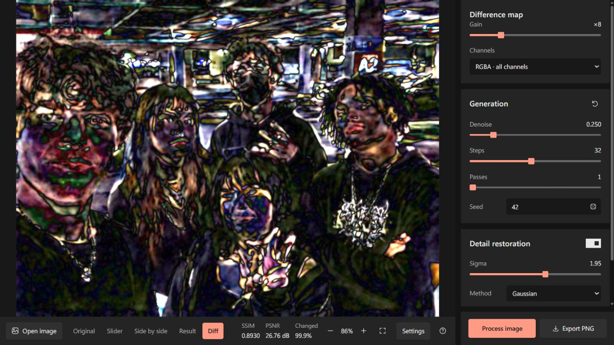

# DeSynth

A tool & pipeline for removing OpenAI & Google's SynthID watermark from images.

## Results

`original.png`, 1460 × 1078. Q4_K_M, 8-step FP32 Lightning, Steps 32,
one pass, Seed 42, restoration at Sigma 1.95, no sharpening.

Left to right: original, **Gaussian**, **Edge**, at Denoise **0.25**.
Matching crops, enlarged without adding detail.



| Metric | Gaussian 0.25 | Edge 0.25 |
|---|---:|---:|
| PSNR ↑ | 32.72 dB | 33.77 dB |
| SSIM ↑ | 0.9533 | 0.9608 |
| MAE ↓ | 3.85 | 3.57 |
| Sampling steps | 8 | 8 |

Edge keeps contours closer to the source,
especially lettering and print. Similarity scores do not establish watermark removal.

## How it works

Qwen-Image + Lightning runs img2img. Frequency restoration combines its
low-frequency content with fine detail from the source. The RGBA output retains
the original dimensions and alpha channel.

## Usage

### Setup

Install [GNU Make](https://www.gnu.org/software/make/) and the tools for your OS:

- **Windows:** [MSYS2](https://www.msys2.org/) provides Make;
  [Visual Studio Build Tools](https://visualstudio.microsoft.com/visual-cpp-build-tools/)
  provides MSVC. Select **Desktop development with C++** and a **Windows SDK**.
- **macOS:** [Xcode Command Line Tools](https://developer.apple.com/documentation/xcode/installing-the-command-line-tools).
- **Linux:** your distribution's compiler tools; see the
  [Ubuntu setup guide](https://ubuntu.com/developers/docs/howto/gcc-setup/).

Linux/macOS also need `curl` and `tar`. From the repository folder:

```sh
make setup
make start
```

`make setup` finds compatible Rust, Python, Node.js and pnpm, downloading missing
tools into `.tools/`. It installs dependencies into `.venv/` and `node_modules/`,
builds the app and prepares models in `inference/models/`. On the first install,
choose a model or accept **Q4_K_M**, the smaller default. Rerunning setup reuses
installed tools and model files and resumes interrupted model downloads.
Keep the included `inference/models/embeds_cache.pt`; VAE and model configs use
the Hugging Face cache.

`make start` builds and starts the complete app at **http://127.0.0.1:8758**.
The Rust server serves the interface and starts the Python worker automatically.
Stop everything with **Ctrl+C**. Use `make start PORT=9000` to change the port.

Setup selects CUDA when a working NVIDIA GPU is detected; otherwise it installs
CPU dependencies. To choose explicitly, use `make setup BACKEND=cpu` or `BACKEND=cuda`.
Use `make doctor` to check setup and `make help` to list commands.

### Models

One GGUF model and one Lightning adapter are required:

| File in `inference/models/` | Size | Use |
|---|---:|---|
| `Qwen-Image-2512-Q4_K_M.gguf` | ~13 GB | Default model |
| `Qwen-Image-2512-Q8_0.gguf` | ~21.8 GB | Optional, more memory required |
| `Qwen-Image-2512-Lightning-8steps-V1.0-fp32.safetensors` | ~1.7 GB | Default adapter |
| `Qwen-Image-2512-Lightning-4steps-V1.0-fp32.safetensors` | ~1.7 GB | Alternative adapter |

Sources: [GGUF models](https://huggingface.co/Frederic75/Qwen-Image-2512-GGUF)
and [Lightning adapters](https://huggingface.co/lightx2v/Qwen-Image-2512-Lightning).
Choose one adapter per run in **Settings → Lightning adapter**. Automatic prefers
8-step FP32. Other quantizations of Qwen-Image-2512 can be selected in Settings
or with `--transformer`.

To add Q8 or the 4-step adapter:

```sh
make models MODEL=q8
make models LIGHTNING=4
```

### GUI



Open an image, adjust the sliders and click **Process image**. Use the bottom
toolbar to compare images, drag the divider or view Diff. Restoration sliders
update the result without another generation. **Export PNG** saves the result;
in Original or Diff, it saves that image.

**Settings** contains models, device options and presets. **Refresh** finds newly
added models; **Save settings** applies choices. Sequential offload uses RAM to
reduce VRAM use. Leave Precision on Auto.



### CLI

Pass processing options through `ARGS`. `INPUT` defaults to `original.png`.

```sh
# Process original.png with automatic model selection
make run ARGS="--seed 42"

# Repeat with Edge restoration
make run ARGS="--seed 42 --restore-mode edge"

# Select Q8 explicitly
make run ARGS="--transformer inference/models/Qwen-Image-2512-Q8_0.gguf --seed 42"
```

For `original.png`, final images and `comparison_...` PNGs go to `out/` with
short names such as `Original_desynth_s32_d0.250_p1_r1.95_edge.png`.
Repeated settings update these reference images. Full runs, settings and
intermediates stay in the local `out/runs/` archive. Git includes reference results
from `original.png`; other runs and intermediate `_clean` images stay local.

### Flags

Defaults below assume the 8-step adapter.

| Flag | Default | When to use |
|---|---|---|
| `--seed N` | Random | Repeat a run with the same settings |
| `--denoise X [X ...]` | `0.25` | Control starting noise; lower values preserve more detail |
| `--steps N` | `32` | Full schedule; at Denoise 0.25, 32 gives 8 sampling steps |
| `--passes N` | `1` | Process the previous result again |
| `--restore-sigma X` | `1.95` | Higher values restore larger structures from the source |
| `--restore-mode M` | `gaussian` | Use `edge` for more source detail around contours |
| `--unsharp X` | `0` | Sharpen after restoration |
| `--no-restore` | Off | Skip source detail restoration |
| `--keep-intermediate` | Off | Also save the image before restoration |
| `--transformer PATH` | Automatic, prefers Q4 | Select a GGUF model |
| `--lightning PATH` | Automatic, prefers 8-step FP32 | Select a Lightning adapter |

The 4-step adapter keeps its CLI default of 8 total steps. Set `--steps 16`
at Denoise 0.25 for four sampling steps. Use `make run ARGS="--help"` for all options.

### Quality check

```sh
make compare OUTPUT=out/Original_desynth_s32_d0.250_p1_r1.95.png
make diff OUTPUT=out/Original_desynth_s32_d0.250_p1_r1.95.png GAIN=8
```

`make compare` prints similarity metrics. `make diff` saves a visible RGBA difference
map; Gain amplifies small changes. Black means identical pixels.



## Development

The Rust workspace is in `backend/crates/`, the Python inference worker in
`inference/`, and the React/TypeScript frontend in `web/`. Image comparison,
RGBA diff and detail restoration run in Rust.

| Command | Checks |
|---|---|
| `make backend-check` | Rust formatting, Clippy and all workspace tests |
| `make web-check` | TypeScript, lint, formatting, architecture and frontend tests |
| `make inference-check` | Pylint and Python worker tests |
| `make inference-lint` | Pylint only |
| `make web-format` | Apply frontend formatting |

For frontend live reload, run `make start GUI_ARGS="--no-browser"`, then
`make web-dev` in another terminal. The dev UI opens at **http://127.0.0.1:3000**
and uses the backend on port 8758. Pass the same `PORT` to both commands if changed.

## Hardware

Tested on an RTX 5070 Ti with 16 GB VRAM and 64 GB RAM. CUDA uses sequential
CPU offload by default. If memory runs out, use Q4 or a smaller input image.

## Limitations

- Higher Denoise and repeated passes can change faces, text and shapes.
- Detail restoration cannot recover every structure altered by generation.

## Credits

Original project: [0xROOTPLS/DeSynth](https://github.com/0xROOTPLS/DeSynth).
Baseline workflow: [00quebec/Synthid-Bypass](https://github.com/00quebec/Synthid-Bypass).
Models: [Qwen-Image](https://huggingface.co/Qwen/Qwen-Image-2512)
and [LightX2V Lightning](https://huggingface.co/lightx2v/Qwen-Image-2512-Lightning).
