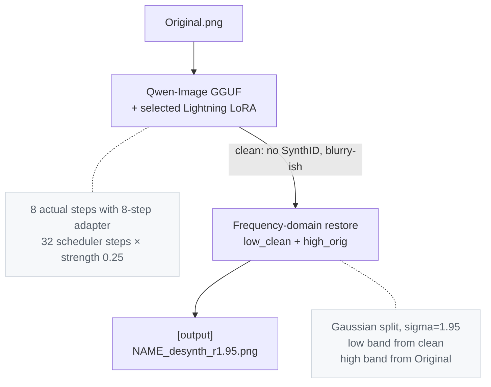

# Desynth

A tool & pipeline for removing OpenAI & Google's SynthID watermark from images.
This project is intended solely for research, education, and authorized evaluation.

## Results
Edge Mode:

Gaussian Mode (Default):


## Metrics
All scores are input image vs output via the included `compare.py`.

### Against other research (Gemini/Google, 2752×1536)

| metric                 | our method | [competitor](https://github.com/00quebec/Synthid-Bypass) |
|------------------------|--------------:|-----------------:|
| PSNR                   |  **28.75 dB** |  20.21 dB        |
| SSIM                   |     **0.946** |     0.624        |
| SSIM (low-frequency)   |     **0.944** |     0.812        |
| SSIM (high-frequency)  |     **0.987** |     0.641        |
| MAE (lower is better)  |      **5.33** |    12.18         |
| Output resolution      |   2752×1536   |    1501×835      |
| SynthID verdict        |   not found   |    not found     |


### Our own test image (GPT Image 2.0/OpenAI, 1460×1078)

| metric                 | gaussian (default) | edge mode |
|------------------------|--------------:|--------------:|
| PSNR                   |  **32.47 dB** |   31.47 dB    |
| SSIM                   |     **0.956** |     0.948     |
| SSIM (low-frequency)   |     **0.959** |     0.955     |
| SSIM (high-frequency)  |     **0.991** |     0.984     |
| MAE                    |      **3.82** |     4.08      |
| SynthID verdict        |   not found   |   not found   |

* Edge mode trades a small amount of measurable detail for better perceptual
shape continuity at contours.


## How it works



## Usage

### Install and prepare

Install Python 3.11 and a working GNU Make, then open a terminal in the repository root.
On Windows, use the [Python 3.11.9 64-bit installer](https://www.python.org/downloads/release/python-3119/)
and ensure GNU Make is available as `make` in `PATH`.
No virtual environment activation is needed.

```powershell
make setup
```

If GNU Make is unavailable or fails to start, the same setup can be run directly:

```powershell
py -3.11 scripts/project.py setup
```

On Linux/macOS, replace `py -3.11` with `python3.11`. The helper also accepts
`--venv` and `--backend` options; `--backend` accepts `auto`, `cuda`, or `cpu`.

`setup` creates `.venv`, installs all dependencies (including comparison tools),
downloads missing GGUF and LoRA model files, caches the VAE and pipeline configs
from Hugging Face, and runs a readiness check. Existing model files are skipped.
New model downloads go into `ai/`: Q4_K_M and the 8-step FP32 Lightning adapter
total approximately 14.7 GB. Allow additional space for the virtual environment
and Hugging Face cache. Existing GGUF and Lightning files in `ai/` or the repository
root are reused; setup does not download another quantization just because Q4 is
absent. Keep the included `embeds_cache.pt`: the pipeline requires these precomputed embeddings.

`make` alone shows help. Individual preparation steps are available:

| target | action |
|--------|--------|
| `make venv` | create the virtual environment |
| `make install` | install dependencies without downloading model files |
| `make models` | download missing GGUF and LoRA model files |
| `make prepare` | cache the VAE and pipeline configs from Hugging Face |
| `make doctor` | check Python, imports, PyTorch/CUDA, and model assets without loading the large pipeline |

`LIGHTNING=auto` prefers an installed 8-step adapter, falls back to an installed
4-step adapter, and downloads 8-step FP32 only when neither is installed. To
prepare a specific adapter, use `make models LIGHTNING=8` or `LIGHTNING=4`.
The direct helper accepts the equivalent `--lightning auto`, `--lightning 8`,
or `--lightning 4`. These options select the adapter to prepare or check;
inference selection is described below.

By default, `PYTHON` is `py -3.11` on Windows and `python3.11` elsewhere.
`VENV` defaults to `.venv`. Override either when needed:

```powershell
make setup PYTHON="py -3.11" VENV=.venv
```

`BACKEND=auto` (the default) selects CUDA dependencies on Windows/Linux and
CPU dependencies on macOS. Choose `BACKEND=cpu` for a machine without NVIDIA
CUDA, or `BACKEND=cuda` explicitly. Use the same override for subsequent
installation commands:

```powershell
make setup BACKEND=cpu
```

The CUDA dependency set is in `requirements.txt`; the CPU dependency set is in
`requirements_mac.txt`. The pipeline selects CUDA, Apple MPS, or CPU according to
the hardware available to PyTorch.

Models can also be downloaded manually into `ai/`. The current layout is:

```text
DeSynth/
├── ai/
│   ├── Qwen-Image-2512-Q4_K_M.gguf
│   ├── Qwen-Image-2512-Q8_0.gguf
│   ├── Qwen-Image-2512-Lightning-4steps-V1.0-fp32.safetensors
│   └── Qwen-Image-2512-Lightning-8steps-V1.0-fp32.safetensors
└── embeds_cache.pt
```

Only one GGUF and one Lightning adapter are required. Q8 is optional and requires
more memory than Q4. Root-level model files remain supported for older installations.

| file                                                      | size   | source |
|-----------------------------------------------------------|--------|--------|
| `Qwen-Image-2512-Q4_K_M.gguf`                             | ~13 GB | [Frederic75/Qwen-Image-2512-GGUF](https://huggingface.co/Frederic75/Qwen-Image-2512-GGUF) |
| `Qwen-Image-2512-Q8_0.gguf`                               | ~21.8 GB | [Frederic75/Qwen-Image-2512-GGUF](https://huggingface.co/Frederic75/Qwen-Image-2512-GGUF) |
| `Qwen-Image-2512-Lightning-8steps-V1.0-fp32.safetensors`  | ~1.7 GB | [lightx2v/Qwen-Image-2512-Lightning](https://huggingface.co/lightx2v/Qwen-Image-2512-Lightning) |
| `Qwen-Image-2512-Lightning-4steps-V1.0-fp32.safetensors`  | ~1.7 GB | [lightx2v/Qwen-Image-2512-Lightning](https://huggingface.co/lightx2v/Qwen-Image-2512-Lightning) |


### GUI

After preparing the environment, launch the local browser interface:

```powershell
make setup
make gui
```

The server opens `http://127.0.0.1:7860` in your browser. Keep the terminal open
while using it, and press `Ctrl+C` there to stop the server. To use another port
or start without opening a browser:

```powershell
make gui PORT=7861 GUI_ARGS="--no-browser"
```

The equivalent direct command on Windows is:

```powershell
.\.venv\Scripts\python.exe gui.py --port 7860
```

Click **Open image** or drag a source into the viewer. A local source/result pair
may be loaded automatically when available. View modes and zoom are available in the bottom toolbar.

- Set denoise, steps, passes, and seed, then click **Process**. Sliders do not
  start model inference.
- After processing, use **Detail restoration** to adjust restoration mode, sigma, and
  unsharp without repeating inference.
- Use Slider to drag a comparison divider, Side by side to view both images, or
  Original and Result to inspect either image separately. Scroll to zoom and
  drag to pan; drag the divider handle to move it at any zoom level.
- Open **Diff** and adjust its gain or select RGBA, RGB, or alpha differences.
- Click **Export PNG** to save the original, result, or visible diff, depending
  on the selected view. Slider and Side by side export the result.

Open **Settings** in the bottom toolbar to choose the **Model**, **Lightning adapter**,
**Device**, **CPU offload**, and **Precision**.
These settings apply when you next click
**Process**. The pipeline reloads when the effective configuration changes;
the job status shows the settings actually used. Available choices follow the
detected hardware.

| setting | choices and effect |
|---------|--------------------|
| Model | A GGUF transformer found in `ai/` or the repository root. Q4 is the default when available; Q8 can be selected explicitly. |
| Lightning adapter | Choose the 4-step or 8-step adapter independently of the GGUF quantization. The installed 8-step FP32 adapter is preferred by default. Changing the adapter reloads the pipeline on the next processing job. |
| Device | Auto selects an available accelerator, otherwise CPU. Select CPU or a detected CUDA GPU explicitly to control where inference runs; Apple MPS is offered on supported machines. |
| CPU offload | Auto chooses the supported default. Sequential moves individual layers from RAM to the GPU, using less VRAM but more transfers. Model moves whole pipeline components, requiring more VRAM and fewer transfers. Disabled keeps the pipeline on the selected device and requires enough device memory for it. |
| Precision | Auto uses BFloat16 where supported, otherwise Float32. CPU uses Float32 with offload disabled. Float16 is unavailable for this Qwen model because numerical overflow can produce black images, even on GPUs that support Float16 operations. This changes computation precision while the selected GGUF model retains its existing quantization. |

Unavailable devices and unsupported combinations are rejected before a job
starts. If a job runs out of memory, its error appears in the interface; select
Sequential offload where supported, a smaller GGUF model, or a smaller image
before processing again.

The interface displays processing progress and saves its working images under
`out/gui/`. Images travel only between your browser and the local server; they
are not uploaded to an external service. Initial model preparation may still
download missing assets from Hugging Face as described above.

### Run

```powershell
make run INPUT=original.png
make run INPUT="path/to/image.png" ARGS="--seed 42"
make run INPUT=original.png LIGHTNING_LORA=ai/Qwen-Image-2512-Lightning-8steps-V1.0-fp32.safetensors
```

To invoke Python directly on Windows:

```powershell
.\.venv\Scripts\python.exe desynth.py original.png --seed 42
.\.venv\Scripts\python.exe desynth.py original.png --transformer ai/Qwen-Image-2512-Q8_0.gguf --lightning ai/Qwen-Image-2512-Lightning-8steps-V1.0-fp32.safetensors
```

On Linux/macOS, use `.venv/bin/python` instead of `.\.venv\Scripts\python.exe`.
If `VENV` was overridden, use that directory in direct Python commands.

The default adapter is the installed 8-step variant, falling back to 4-step.
The 8-step adapter defaults to 32 scheduler steps; with denoise 0.25, img2img
executes 8 actual denoising steps. The 4-step adapter retains the earlier default
of 8 scheduler steps, or 2 actual steps at denoise 0.25. `--steps` overrides this
schedule; selecting 8-step Lightning does not make `--steps 8 --denoise 0.25`
execute eight denoising steps. Explicit GUI step values are also respected.

Output with the 8-step defaults: `out/<name>_desynth_s32_d0.250_p1_r1.95.png`.
Random seed per run by default. `make prepare` caches the VAE and configs ahead of time; otherwise
the first pipeline run downloads them from Hugging Face.

### Flags

| flag                  | default | when to use |
|-----------------------|---------|-------------|
| `--seed N`            | random  | reproducible runs |
| `--denoise X [X X]`   | 0.25    | sweep denoise |
| `--steps N`           | 32 for 8-step / 8 for 4-step | scheduler steps per pass; actual img2img steps depend on denoise |
| `--passes N`          | 1       | iterate img2img |
| `--restore-sigma X`   | 1.95    | tune detail restore |
| `--restore-mode M`    | gaussian | `edge` for shape-coherent contours |
| `--unsharp X`         | 0.0     | post-restore sharpen; 0.2 is the perceptual sweet spot |
| `--no-restore`        | off     | skip the frequency restore step |
| `--keep-intermediate` | off     | save the pre-restore clean output |
| `--transformer PATH`  | Q4_K_M  | try a different GGUF quant |
| `--lightning PATH`    | installed 8-step, then 4-step | choose the Lightning LoRA independently of the transformer |
| `--lightning-scale X` | 0.8     | adjust Lightning adapter strength |

### Quality check

```powershell
make compare INPUT=original.png OUTPUT=out/original_desynth_s8_d0.250_p1_r1.95.png
```

Prints PSNR, SSIM (full + low/high band), MAE, MSE, and per-channel
histogram correlation. Use paths matching your actual input and output filenames
(including their letter case on Linux/macOS).

To save a side-by-side comparison with the metrics:

```powershell
make visual INPUT=original.png OUTPUT=out/original_desynth_s8_d0.250_p1_r1.95.png VISUAL_OUT=out/comparison.png
```

The equivalent direct command on Windows is:

```powershell
.\.venv\Scripts\python.exe compare.py original.png out/original_desynth_s8_d0.250_p1_r1.95.png --visual --visual-out out/comparison.png
```

The saved visualization shows the two images side by side.

### Pixel difference

`diff.py` compares all four RGBA channels, including alpha. `--out` saves a
visible RGBA visualization with opaque display alpha (255). Color differences
are amplified; alpha differences also brighten all three color channels using
`max(abs(RGB delta), abs(alpha delta)) * gain`, clipped to 255. Black indicates
no change; brighter pixels indicate larger changes. The default gain is 8.
Images with different dimensions are rejected.

```powershell
make diff INPUT=original.png OUTPUT=out/original_desynth_s8_d0.250_p1_r1.95.png
```

`DIFF_OUT` defaults to `out/diff.png`; `GAIN` defaults to `8`. The equivalent
direct command on Windows is:

```powershell
.\.venv\Scripts\python.exe diff.py original.png out/original_desynth_s8_d0.250_p1_r1.95.png --out out/diff.png --gain 8
```

Optional outputs are disabled by default:

- `--preview-out PATH` / `PREVIEW_OUT=PATH`: two opaque panels, with RGB
  differences on the left and alpha differences in grayscale on the right.
- `--raw-out PATH` / `RAW_OUT=PATH`: the per-channel RGBA delta. Use `--gain 1`
  / `GAIN=1` for exact values. This data PNG can be fully transparent when alpha
  is unchanged; the main visualization stays visible.

## Files

| file                                                      | role                                                       |
|-----------------------------------------------------------|------------------------------------------------------------|
| `desynth.py`                                              | main pipeline: img2img + restore in one call               |
| `compare.py`                                              | similarity metrics between two images                      |
| `diff.py`                                                 | visible RGBA difference, optional raw delta and channel preview |
| `gui.py`, `web/`                                          | local browser interface for processing, restoration, and image comparison |
| `Makefile`                                                | setup, readiness checks, and image workflow commands        |
| `make/config.mk`, `make/setup.mk`, `make/run.mk`            | shared configuration, setup targets, and run targets        |
| `scripts/project.py`                                      | cross-platform setup and readiness helper                   |
| `requirements.txt`, `requirements_mac.txt`                 | CUDA and CPU dependency entry points                        |
| `embeds_cache.pt`                                         | cached prompt embeddings (~430 KB)            |
| `ai/*.gguf`                                               | selectable Qwen-Image GGUF transformers; Q4 ~13 GB, Q8 ~21.8 GB |
| `ai/*Lightning*.safetensors`                               | selectable 4-step and 8-step Lightning adapters; FP32 ~1.7 GB each |

## Hardware Requirements

Tested on Windows 10, RTX 5060 Ti 8 GB, 32 GB DDR4 RAM.
Sequential CPU offload is required with < 12GB VRAM

## Known limitations

- The reported metrics above were produced with the earlier 4-step adapter workflow.
  An 8-step adapter trades more processing time for a different sampling result;
  quality should be compared with the same image and seed.

## Credits

Baseline workflow and watermark hypothesis from
[00quebec/Synthid-Bypass](https://github.com/00quebec/Synthid-Bypass).
This pipeline reimplements the core idea in plain Python without ComfyUI,
ControlNet, or the face-detail path, and replaces the heavier redraw with a
two-step minimum denoise + frequency-domain restore.
